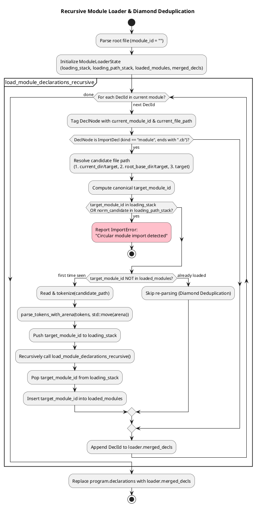

# Multi-File Module Resolution, Scoping & Name Mangling

This document explains how CleanBasic resolves multi-file `.cb` module graphs, normalizes relative paths, handles module aliases, deduplicates diamond imports, detects circular dependencies, enforces `pub` visibility, and mangles C++ identifiers for collision-free Unity Builds.

### Related Documentation
* [CleanBasic Transpiler Architecture & Arena Design](transpiler_architecture.md)
* [Lexical Analysis & Recursive-Descent Parsing](lexer_and_parser.md)
* [Semantic Analyzer: Type Inference, UFCS, Mutability & Fallibility](semantic_analyzer.md)
* [Unity C++17 Emitter, Runtime Preamble & C/C++ Interoperability](cpp_emitter_and_interop.md)

---

## 1. Module Identity & Relative Path Resolution (`src/cleanbasic/ast.hpp`)

In CleanBasic, every `.cb` file is a module. Rather than requiring package manifests or C++ header files, modules import other `.cb` files directly using relative paths:

```vb
import "entities/hero.cb"
import "../shared/math.cb" as smath
```

### 1.1 Path Normalization (`cb::normalize_rel_path`)
`normalize_rel_path(std::string_view raw_path)` splits a slash-separated path into segments:
* Empty segments and `"."` segments are discarded.
* `".."` pops the preceding segment from the stack (unless the stack is empty or already starts with `".."`, in which case `".."` is preserved).
* Segments are rejoined with `"/"`.

### 1.2 Canonical Module IDs (`cb::resolve_module_id`)
Every loaded module is assigned a canonical `module_id` relative to the root entry file's directory:
* The **root entry file** (e.g., `main.cb`) always has an empty module ID: `module_id = ""`.
* When a module with `importer_module_id` imports `import_target`:
  1. `resolve_module_id` extracts the parent directory of `importer_module_id`.
  2. Joins `<importer_dir>/<import_target>` and normalizes it with `normalize_rel_path`.
  3. Strips the trailing `".cb"` extension.

**Example (`tests/cases/nested_modules/`):**
* Root `main.cb` (`module_id = ""`) imports `"combat/battle.cb"` -> `resolved_module_id = "combat/battle"`.
* `combat/battle.cb` (`module_id = "combat/battle"`) imports `"../entities/hero.cb"`:
  * Importer dir is `"combat"`.
  * Combined path is `"combat/../entities/hero.cb"`.
  * Normalized path without extension is `resolved_module_id = "entities/hero"`.

### 1.3 Default vs. Explicit Module Aliases (`cb::default_import_alias`)
Each `import` statement binds a local module alias inside the importing module's scope (`GlobalSymbolTable::modules[importer_module_id][alias] = resolved_module_id`):
* **Default Alias:** If `as <alias>` is omitted, `default_import_alias(import_target)` takes the filename stem after the last `'/'` and strips `".cb"`. For example, `import "entities/hero.cb"` binds the alias `hero`.
* **Explicit Alias:** `import "entities/enemy.cb" as foe` binds the alias `foe` instead of `enemy`. This also allows importing two modules with the same filename from different directories (e.g., `ui/button.cb` and `input/button.cb`).
* **Duplicate Alias Rejection:** If a single module attempts to bind the same import alias twice, `analyze_program()` fails in Pass 1a with:
  `AnalyzerError: Duplicate module import alias '<alias>'.`

---

## 2. Recursive Module Graph Loading (`src/cleanbasic/pipeline.hpp`)

After the root file is lexed and parsed into an initial `AstArena` and `Program`, `cb::transpile_source()` runs `cb::load_module_declarations_recursive()`.



### 2.1 Candidate File Search Order
When resolving `import "path.cb"` from `current_file_path`, the loader checks three candidate filesystem paths in order:
1. `<parent_dir_of(current_file_path)>/<imp.target>` (relative to the importing file)
2. `<loader.root_base_dir>/<imp.target>` (relative to the root entry file's directory)
3. `<imp.target>` (relative to the current working directory)

### 2.2 Diamond Dependency Deduplication
`ModuleLoaderState::loaded_modules` (`std::unordered_set<std::string>`) records every `target_module_id` whose declarations have already been loaded and merged.
* In a diamond dependency graph (e.g., `main.cb` imports both `entities/hero.cb` and `combat/battle.cb`, and `combat/battle.cb` also imports `../entities/hero.cb`), `entities/hero` is lexed, parsed, and emitted into `merged_decls` **exactly once** before its dependents.
* The second `ImportDecl` node is still preserved in `merged_decls` so Pass 1a of the semantic analyzer registers the module alias in the second importer's scope.

### 2.3 Circular Import Detection
`ModuleLoaderState` maintains two active DFS stacks:
* `loading_stack`: Active canonical `module_id` strings on the current recursion path.
* `loading_path_stack`: Active normalized file paths (including the root entry file).

If an `import` targets a module ID in `loading_stack` or a file path in `loading_path_stack`, the loader immediately halts with an `ImportError`:
```text
Circular module import detected when importing '<target>' (module '<target_module_id>').
```

---

## 3. Visibility Rules (`pub` vs. Private)

By default, every `type`, `alias`, and `fn` declared in a CleanBasic module is **private** to that module (`is_pub = false`). Adding the `pub` keyword exports the declaration (`is_pub = true`).

| Access Context | Private Symbol (`is_pub == false`) | Public Symbol (`is_pub == true`) |
| :--- | :--- | :--- |
| **Same Module (`current_module_id == decl.module_id`)** | Allowed (direct unqualified access & local UFCS). | Allowed. |
| **Cross-Module Qualified Call/Type (`mod_alias.Symbol`)** | **Rejected** by `analyze_program()` with `AnalyzerError: Function/Type/Alias '<name>' is private to module '<mod>' (missing 'pub').` | Allowed if `mod_alias` is imported in the current module. |
| **Cross-Module UFCS Call (`recv.method()`)** | **Rejected** (`resolve_func_call` requires `is_pub == true` for functions in the receiver's defining module or imported modules). | Allowed if the receiver's defining module or a directly imported module defines `pub fn method(recv, ...)`. |
| **Transitive (Unimported) Module Access** | **Rejected.** | **Rejected** for direct qualified `unimported_alias.fn()`, because `is_module_alias_in_scope` only checks `symbols.modules[current_module_id]`. |

---

## 4. Internal Symbol Keys & C++ Identifier Mangling (`src/cleanbasic/ast.hpp`)

Because all modules compile into a single C++17 file (`build.cpp`), two different modules might define private or public types and functions with identical names (e.g., `entities/hero.cb` and `entities/enemy.cb` both defining `type Stats` or `fn reset()`). CleanBasic prevents C++ One Definition Rule (ODR) and redefinition collisions at two levels:

### 4.1 Symbol Table Keys (`cb::symbol_key`)
Inside `GlobalSymbolTable`, declarations are indexed by `symbol_key(module_id, name)`:
* **Root module (`module_id == ""`)**: `"<name>"` (e.g., `"main"`, `"Player"`)
* **Imported module (`module_id != ""`)**: `"<module_id>::<name>"` (e.g., `"entities/hero::Hero"`, `"combat/battle::engage"`)

`split_symbol_key(key)` splits a `"::"` key back into `{module_id, base_name}`.

### 4.2 C++ Identifier Mangling (`make_cpp_type_name` & `make_cpp_fn_name`)
`sanitize_module_id(module_id)` replaces every non-alphanumeric character (such as `'/'` or `'.'`) with `'_'`. The emitter then uses `make_cpp_type_name` and `make_cpp_fn_name` to compute each symbol's emitted C++ identifier:

| Declaration Kind | Root Module (`module_id == ""`) | Imported Module (`module_id == "entities/hero"`) | `extern` Declaration (`is_extern == true`) |
| :--- | :--- | :--- | :--- |
| **`type Hero`** | `struct Hero` | `struct cb_entities_hero__Hero` | Unmangled (`Hero`, not re-emitted as a struct if extern) |
| **`alias Id = int`** | `using Id = int;` | `using cb_entities_hero__Id = int;` | N/A (`extern alias` is forbidden) |
| **`fn make_hero()`** | `make_hero(...)` | `cb_entities_hero__make_hero(...)` | Unmangled (`make_hero(...)`) |
| **`fn main()`** | `cb_main()` (called by generated `int main()`) | `cb_entities_hero__main()` | Unmangled |

Because `extern` types and functions bind to existing C/C++ symbols from `import header` files or linked libraries, their C++ names are **never mangled**, regardless of which `.cb` module declares them.
