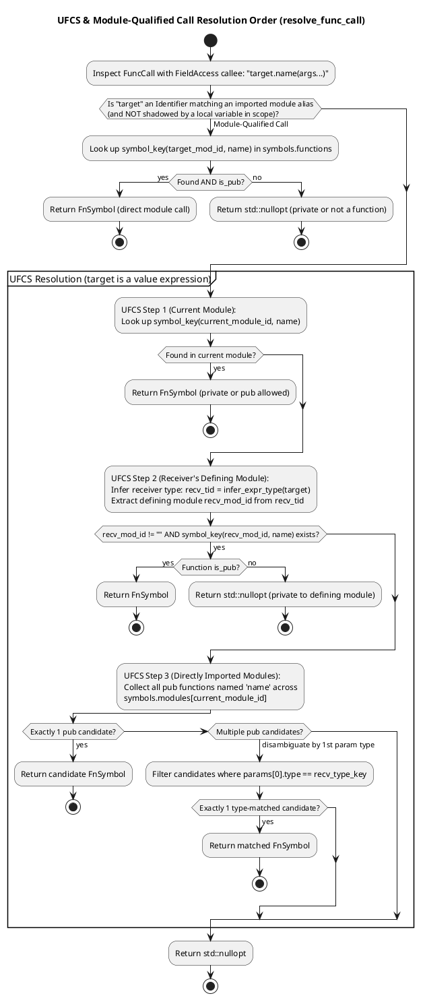

# Semantic Analyzer: Type Inference, UFCS, Mutability & Fallibility

This document describes CleanBasic's semantic analysis phase (`src/cleanbasic/analyzer.hpp`), including the `GlobalSymbolTable` architecture, two-pass symbol registration, type alias cycle detection, Unified Function Call Syntax (UFCS) resolution, struct constructor resolution, `const`/`dim`/`byref` mutability enforcement, and static error-handling verification.

### Related Documentation
* [CleanBasic Transpiler Architecture & Arena Design](transpiler_architecture.md)
* [Lexical Analysis & Recursive-Descent Parsing](lexer_and_parser.md)
* [Multi-File Module Resolution, Scoping & Name Mangling](modules_and_symbols.md)
* [Unity C++17 Emitter, Runtime Preamble & C/C++ Interoperability](cpp_emitter_and_interop.md)

---

## 1. `GlobalSymbolTable` & Symbol Records (`src/cleanbasic/analyzer.hpp`)

`cb::analyze_program(AstArena& arena, const Program& program)` builds and validates a `cb::GlobalSymbolTable`:

```cpp
struct GlobalSymbolTable {
    std::unordered_map<std::string, TypeSymbol> types;
    std::unordered_map<std::string, AliasSymbol> aliases;
    std::unordered_map<std::string, FnSymbol> functions;
    std::vector<std::string> headers;
    std::vector<std::string> link_libs;
    std::unordered_map<std::string, std::unordered_map<std::string, std::string>> modules;
    std::unordered_map<std::string, std::unordered_map<std::string, VarSymbol>> fn_scopes;
    TypeId type_int = INVALID_ID;
    TypeId type_float = INVALID_ID;
    TypeId type_str = INVALID_ID;
    TypeId type_bool = INVALID_ID;
    TypeId type_void = INVALID_ID;
    TypeId type_auto = INVALID_ID;
    TypeId type_null = INVALID_ID;
    TypeId type_any = INVALID_ID;
    TypeId type_err = INVALID_ID;
    TypeId type_cptr = INVALID_ID;
};
```

### Symbol Table Components
* **`types` (`key -> TypeSymbol`)**: Stores every user-defined and built-in struct type (`name`, `module_id`, `key`, `fields` map of `field_name -> TypeId`, `field_order` vector of `FieldDecl`, `is_pub`, `is_extern`, and mangled `cpp_name`).
* **`aliases` (`key -> AliasSymbol`)**: Stores every `alias Name = TargetType` declaration (`name`, `module_id`, `key`, `target_type`, `is_pub`, `cpp_name`).
* **`functions` (`key -> FnSymbol`)**: Stores every function signature (`name`, `module_id`, `key`, resolved `params`, resolved `return_type`, `is_fallible`, `is_pub`, `is_extern`, `cpp_name`).
* **`headers` & `link_libs`**: Deduplicated ordered lists of `import header "..."` and `import link "..."` targets across all loaded modules.
* **`modules` (`importer_module_id -> {alias -> resolved_module_id}`)**: Per-module import alias lookup tables.
* **`fn_scopes` (`fn_key -> {var_name -> VarSymbol}`)**: Captured local variable and parameter scopes for each analyzed function.

---

## 2. Built-in Types and Functions (`cb::register_builtins`)

Before inspecting user declarations, `register_builtins(arena, symbols)` interns all built-in `TypeNode` entries into `arena.types` and registers core symbols:

### 2.1 Built-in Types (`is_builtin_type_name`)
| CleanBasic Type | `GlobalSymbolTable` Handle | Description |
| :--- | :--- | :--- |
| `int` | `symbols.type_int` | Signed integer primitive. |
| `float` | `symbols.type_float` | Double-precision floating-point primitive (`double`). |
| `str` | `symbols.type_str` | UTF-8 string value (`std::string`). |
| `bool` | `symbols.type_bool` | Boolean primitive (`true` / `false`). |
| `cptr` | `symbols.type_cptr` | Opaque C pointer (`void*`) for C/C++ FFI handles. |
| `err` | `symbols.type_err` | Built-in structured error type (`cb_error`) with `.msg as str` and `.code as int` fields. |
| `list[T]` | Parametric `TypeNode{"list", {T}}` | Dynamic contiguous array (`std::vector<T>`). |
| `dict[K, V]` | Parametric `TypeNode{"dict", {K, V}}` | Hash table (`std::unordered_map<K, V>`). |
| `void`, `auto`, `null`, `any` | Internal compiler type handles | Used for void return types, type inference fallbacks, `null` literals, and polymorphic built-in parameters. |

### 2.2 Built-in Functions (`is_builtin_symbol_name`)
* **`print(...)`**: Variadic standard output function (infallible, lowered to `(std::cout << ... << std::endl)` in the emitter).
* **`len(container as any) as int`**: Returns the integer length of a `list[T]`, `dict[K, V]`, or `str` (`static_cast<int>(container.size())`).
* **`str(val as any) as str`**: Converts numeric, boolean, or `err` values to `std::string`.
* **`error(msg..., [code=N])`**: Special built-in intrinsic validated by `is_error_builtin_call()`. Raises and returns a `cb_error{msg, code}` value from a `can error` function (default `code = 1`).

---

## 3. Two-Pass Global Registration & Statement Analysis

Because CleanBasic allows functions and struct fields to reference types and aliases declared later in the same file (or in imported modules), `analyze_program()` executes in two distinct phases (with Pass 1 split into two sub-passes):

```plantuml
@startuml
skinparam monochrome false
title Two-Pass Semantic Analysis (cb::analyze_program)

start
:register_builtins(arena, symbols);

partition "Pass 1a: Module Imports, Aliases & Type Headers" {
  :Iterate over program.declarations:
  1. ImportDecl ("header", "link", "module"):
     - Deduplicate headers & link_libs
     - Register modules[module_id][alias] = resolved_mod
     - Reject duplicate module aliases in same module
  2. AliasDecl:
     - Register AliasSymbol in symbols.aliases[key]
  3. TypeDecl:
     - Register TypeSymbol shell in symbols.types[key]
     - Pre-register canonical TypeNode in arena.types;
}

partition "Pass 1b: Struct Fields & Function Signatures" {
  :Iterate over program.declarations:
  1. TypeDecl:
     - Resolve each field's TypeId through resolve_alias()
     - Populate TypeSymbol::fields[field_name]
  2. FnDecl:
     - Resolve parameter TypeIds and return_type through resolve_alias()
     - Register FnSymbol in symbols.functions[key];
}

partition "Pass 2: Function Body & Statement Validation" {
  :Iterate over non-extern FnDecl in program.declarations:
  - Seed local scope with resolved function parameters (including is_byref)
  - Call analyze_block() -> analyze_stmt() for every statement
  - Infer variable types, check mutability, validate UFCS/visibility,
    and enforce static fallibility rules;
}

stop
@enduml
```

---

## 4. Type Alias Resolution & Cycle Detection (`resolve_alias_node` & `resolve_alias`)

Modules can define local or public type aliases (`alias UserId = int` or `pub alias HeroList = list[hero.Hero]`), including chains of aliases across modules.

`cb::resolve_alias_node(arena, symbols, current_module_id, tid)` unwraps alias chains safely:
1. Starts with `curr = arena.types[tid]` and `active_mod_id = current_module_id`.
2. Maintains a `std::unordered_set<std::string> seen` of visited alias symbol keys.
3. In a `while` loop, computes `key = resolve_symbol_key(symbols, active_mod_id, curr.name)` and looks up `key` in `symbols.aliases`:
   * If not an alias, or if accessed via qualified `mod.Alias` when `!is_pub`, stops unwrapping.
   * **Cycle Detection:** If `key` is already in `seen` (e.g., `alias A = B` and `alias B = A`), breaks out of the loop immediately to prevent infinite recursion.
   * Otherwise, inserts `key` into `seen`, updates `active_mod_id = alias_sym.module_id` (so relative type references inside the alias resolve in the alias's defining module), and advances `curr` to the target `TypeNode`.
4. Finally, if `curr.name` resolves to a user-defined `TypeSymbol` in `symbols.types`, normalizes `curr.name` to the canonical `TypeSymbol::key` (e.g., `"entities/hero::Hero"`).

---

## 5. Function Call, UFCS & Struct Constructor Resolution

In the AST, every `callee(args...)` or `target.name(args...)` expression is represented as a `FuncCall`. The semantic analyzer disambiguates function calls, UFCS method calls, and struct constructors via `resolve_func_call()` and `resolve_struct_constructor()`.

### 5.1 Unified Function Call Syntax (`cb::resolve_func_call`)

When `call.callee` is a `FieldAccess` (`target.name(args...)`), `resolve_func_call()` checks four possibilities in strict priority order:



When a UFCS call matches a free function `fn(first_param, ...)`, the emitter prepends `target` as the first positional argument (`fn(target, args...)`). If `first_param` is declared `byref`, `target` is passed by mutable C++ reference (`T&`), mutating the caller's value in place.

### 5.2 Struct Constructor Resolution (`cb::resolve_struct_constructor`)

CleanBasic uses pure value semantics for struct instantiation: `Player(name="Alice", health=100)` or `player.Player(name="Alice", health=100)`.
* `resolve_struct_constructor()` checks whether `call.callee` is an `Identifier` or module-qualified `FieldAccess` (`mod_alias.TypeName`).
* If the resolved symbol key does not match a function in `symbols.functions`, it unwraps any type aliases (checking `is_pub` on cross-module hops) and looks up the key in `symbols.types`.
* When matched, `infer_expr_type()` infers the expression type as the canonical struct `TypeId`, and the emitter lowers the call to a C++ aggregate initializer `cpp_name{field1, field2, ...}` ordered according to `TypeSymbol::field_order` (filling any omitted fields with `default_value_for_type()`).

---

## 6. Type Inference & Mutability Enforcement

### 6.1 Local Type Inference (`cb::infer_expr_type`)
When a variable is declared with `dim x = <expr>` or `const x = <expr>` without an explicit `as Type` annotation, `analyze_stmt()` infers the type of `<expr>` via `infer_expr_type()`:
* **Literals:** `NumberLiteral` -> `int` or `float` (if `raw` contains `'.'`); `StringLiteral` -> `str`; `BoolLiteral` -> `bool`; `ListLiteral` -> `list[infer(elem[0])]` (defaults to `list[int]` if empty); `DictLiteral` -> `dict[infer(key[0]), infer(val[0])]` (defaults to `dict[str, int]` if empty).
* **Variables & Accessors:** `Identifier` -> looks up `scope[name].type_id`; `FieldAccess` -> looks up `TypeSymbol::fields[field_name]`; `IndexAccess` -> unwraps element type `T` from `list[T]` or value type `V` from `dict[K, V]`.
* **Calls:** `FuncCall` -> returns resolved `FnSymbol::return_type` or constructed `TypeSymbol` type.
* **Operators:**
  * `not`, `and`, `or`, `==`, `!=`, `<`, `>`, `<=`, `>=` -> `bool`.
  * `&` (string concatenation) -> `str`.
  * Arithmetic (`+`, `-`, `*`, `/`) -> promotes to `str` if either operand is `str`, promotes to `float` if either operand is `float`, else preserves the left operand's type.

### 6.2 `const` vs. `dim` & Variable Declaration Rules
In `analyze_stmt()` (`VarAssignment`):
1. **Explicit Declaration Required:** Reassigning an identifier `x = expr` (where neither `is_dim` nor `is_const` is set) checks `scope.find(x)`. If `x` has not been declared in the current function scope, the analyzer reports:
   `AnalyzerError: Undeclared variable '<name>'. Use 'dim' or 'const' to declare variables.`
2. **`const` Immutability:** Variables declared with `const x = expr` record `VarSymbol::is_const = true` (and emit `const <type> x = ...;` in C++). Any subsequent reassignment `x = new_val` is rejected at compile time with:
   `AnalyzerError: Cannot reassign const variable '<name>'.`
3. **`byref` Parameter Mutability:** Function parameters are passed by value by default (`is_byref = false`). When a parameter is marked `byref p as Player`, `VarSymbol::is_byref = true` is recorded in the function scope and emitted as a mutable C++ reference (`Player& p`).

### 6.3 `select case` Type Constraint
To guarantee that every `select case` statement lowers to a fast, native C++ `switch` jump table without hidden string comparisons or branching overhead, `analyze_stmt()` verifies the target expression's inferred type:
```cpp
const TypeId target_tid = infer_expr_type(arena, sel_stmt.target, symbols, scope, state.module_id);
if (target_tid != symbols.type_int && target_tid != symbols.type_bool) {
    set_analyzer_error(state, stmt_node.line, stmt_node.col,
        "select case expression must be of type 'int' or 'bool'");
    return;
}
```

---

## 7. Static Fallibility & Error-Handling Verification

CleanBasic enforces exhaustive error handling at compile time without C++ exceptions.

### 7.1 Calling `error(...)` (`validate_expr_calls`)
Whenever `error(msg, [code=N])` is called:
1. The enclosing function **must** declare `can error` (`fn.is_fallible == true`). Calling `error(...)` inside an infallible function fails with:
   `AnalyzerError: Cannot call 'error(...)' inside infallible function '<fn>'; add 'can error' to the function signature.`
2. At least one positional message argument must be provided (`'error(...)' requires at least one message argument.`).
3. Only `code=<int_expr>` is permitted as a named argument (`Unknown named argument '<name>' in 'error(...)'; only 'code=' is supported.`).

### 7.2 Fallible Function Calls & Implicit Bubbling (`check_fallible_usage`)
When function `caller` invokes a fallible function `callee` (`callee.is_fallible == true`):
* **Case 1: Active `on error` Handler in Scope (`has_active_on_error == true`)**
  The call is valid even if `caller` is infallible. Errors from `callee` will be routed to the active `on error` block in the current scope.
* **Case 2: No `on error` Handler, and `caller` Declares `can error` (`caller.is_fallible == true`)**
  The call is valid. `check_fallible_usage()` sets `stmt.implicit_bubble = true` on the enclosing `VarAssignment` or `ExprStmt`, instructing the emitter to automatically unpack the error and bubble it upward if `cb_has_error(_err)` is true.
* **Case 3: No `on error` Handler, and `caller` is Infallible (`caller.is_fallible == false`)**
  Compilation fails immediately with an `AnalyzerError`:
  `Unhandled error: function returns an error but caller does not declare 'can error' or have an active 'on error' block (function '<caller>' calls fallible function '<callee>').`

### 7.3 `on error` Scope Activation & Mandatory Control-Flow Exit (`stmt_list_has_exit`)
When `analyze_stmt()` encounters an `ErrorBlock` (`on error e ... end error`):
1. It creates a child scope `err_scope` with `e` bound to built-in type `err` (`cb_error`, providing `e.msg` as `str` and `e.code` as `int`).
2. It analyzes the statements inside `err_block.body`.
3. It verifies that `stmt_list_has_exit(arena, err_block.body)` is `true`—meaning the last statement in the `on error` block is an explicit control-flow exit:
   * `return [<expr>]` (`ReturnStmt`)
   * `break` (`BreakStmt`)
   * `error(...)` (`ExprStmt` calling the `error` intrinsic)
   If the block can fall through without exiting, the analyzer reports:
   `AnalyzerError: 'on error' block must terminate with an explicit control-flow exit ('return', 'error(...)', or 'break').`
4. Once validated, `has_active_on_error = true` is set for all subsequent statements in the enclosing block (and inherited by nested `if` / `for` / `select case` blocks within that scope).

### 7.4 Return Value Consistency
For every `ReturnStmt`, `analyze_stmt()` verifies (unless the statement is `return error(...)`):
* A void function (`return_type == void`) cannot return a value (`Function '<fn>' returns void, but a value was returned.`).
* A value-returning function (`return_type != void`) cannot execute a bare `return` without a value (`Function '<fn>' expects a return value, but none was provided.`).
