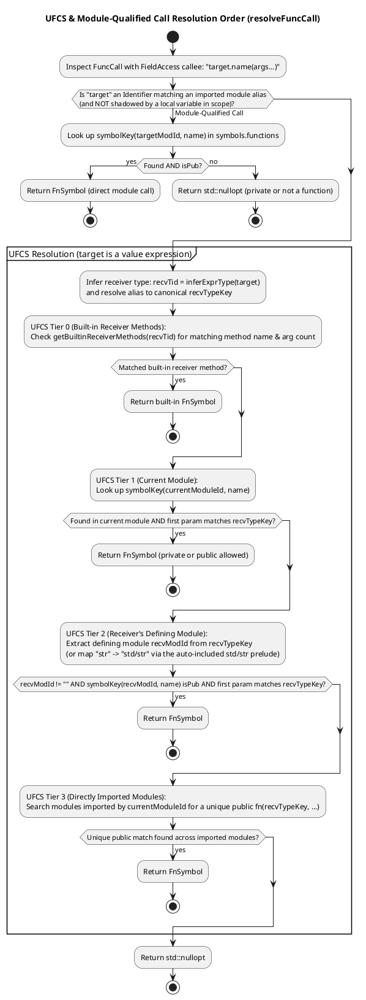

# Semantic Analyzer: Type Inference, UFCS, Mutability & Fallibility

This document describes CleanBasic's semantic analysis phase (`src/cleanbasic/symbols.hpp` and `src/cleanbasic/analyzer.hpp`), including the `GlobalSymbolTable` architecture, two-pass symbol registration, type alias cycle detection, Unified Function Call Syntax (UFCS) resolution, struct constructor resolution, `const`/`dim`/`byref` mutability enforcement, and static error-handling verification.

### Related Documentation
* [CleanBasic Transpiler Architecture & Arena Design](transpiler_architecture.md)
* [Lexical Analysis & Recursive-Descent Parsing](lexer_and_parser.md)
* [Multi-File Module Resolution, Scoping & Name Mangling](modules_and_symbols.md)
* [Unity C++17 Emitter, Runtime Preamble & C/C++ Interoperability](cpp_emitter_and_interop.md)

---

## 1. `GlobalSymbolTable` & Symbol Records (`src/cleanbasic/analyzer.hpp`)

`cb::analyzeProgram(AstArena& arena, const Program& program)` builds and validates a `cb::GlobalSymbolTable` (defined in `src/cleanbasic/symbols.hpp`):

```cpp
struct GlobalSymbolTable {
    std::unordered_map<std::string, TypeSymbol> types;
    std::unordered_map<std::string, AliasSymbol> aliases;
    std::unordered_map<std::string, EnumSymbol> enums;
    std::unordered_map<std::string, UnionSymbol> unions;
    std::unordered_map<std::string, ConstSymbol> constants;
    std::unordered_map<std::string, FnSymbol> functions;
    std::vector<std::string> headers;
    std::vector<std::string> linkLibs;
    std::unordered_map<std::string, std::unordered_map<std::string, std::string>> modules;
    std::unordered_map<std::string, std::unordered_map<std::string, VarSymbol>> fnScopes;
    std::unordered_set<std::string> explicitlyImportedModules;
    std::unordered_set<std::string> referencedModules;
    std::unordered_map<std::string, std::string> headerModules;
    bool hasStdStr = false;
    TypeId typeInt = INVALID_ID;
    TypeId typeFloat = INVALID_ID;
    TypeId typeStr = INVALID_ID;
    TypeId typeBool = INVALID_ID;
    TypeId typeVoid = INVALID_ID;
    TypeId typeAuto = INVALID_ID;
    TypeId typeNull = INVALID_ID;
    TypeId typeErr = INVALID_ID;
    TypeId typeCptr = INVALID_ID;
    TypeId typeBytes = INVALID_ID;
};
```

### Symbol Table Components
* **`types` (`key -> TypeSymbol`)**: Stores every user-defined and built-in struct type (`name`, `moduleId`, `key`, `fields` map of `fieldName -> TypeId`, `privateFields` set of private field names, `fieldOrder` vector of `FieldDecl`, `isPub`, `isExtern`, and mangled `cppName`).
* **`enums` (`key -> EnumSymbol`)**: Stores every `enum Name` declaration (`name`, `moduleId`, `key`, `isPub`, `members`, `memberValues` map, `cppName`).
* **`unions` (`key -> UnionSymbol`)**: Stores every `union Name` declaration (`name`, `moduleId`, `key`, `isPub`, `variants`, `variantTypes` map, `variantIndices` map, `cppName`).
* **`aliases` (`key -> AliasSymbol`)**: Stores every `alias Name = TargetType` declaration (`name`, `moduleId`, `key`, `targetType`, `isPub`, `cppName`).
* **`constants` (`key -> ConstSymbol`)**: Stores every module-level `const name = expr` declaration (`name`, `moduleId`, `key`, `typeId`, `isPub`, `cppName`).
* **`functions` (`key -> FnSymbol`)**: Stores every function signature (`name`, `moduleId`, `key`, resolved `params`, resolved `returnType`, `isFallible`, `isPub`, `isExtern`, `cppName`).
* **`headers` & `linkLibs`**: Deduplicated ordered lists of `import header "..."` and `import link "..."` targets across all loaded modules.
* **`modules` (`importerModuleId -> {alias -> resolvedModuleId}`)**: Per-module import alias lookup tables.
* **`fnScopes` (`fnKey -> {varName -> VarSymbol}`)**: Captured local variable and parameter scopes for each analyzed function.

---

## 2. Built-in Types and Functions (`cb::registerBuiltins`)

Before inspecting user declarations, `registerBuiltins(arena, symbols)` interns all built-in `TypeNode` entries into `arena.types` and registers core symbols:

### 2.1 Built-in Types (`isBuiltinTypeName`)
| CleanBasic Type | `GlobalSymbolTable` Handle | Description |
| :--- | :--- | :--- |
| `int` | `symbols.typeInt` | Signed integer primitive. |
| `float` | `symbols.typeFloat` | Double-precision floating-point primitive (`double`). |
| `str` | `symbols.typeStr` | UTF-8 string value (`std::string`). |
| `bytes` | `symbols.typeBytes` | Raw binary buffer (`std::vector<uint8_t>`). |
| `bool` | `symbols.typeBool` | Boolean primitive (`true` / `false`). |
| `cptr` | `symbols.typeCptr` | Opaque C pointer (`void*`) for C/C++ FFI handles. |
| `err` | `symbols.typeErr` | Built-in structured error type (`CbError`) with `.msg as str`, `.code as int`, `.file as str`, and `.line as int` fields. |
| `list[T]` | Parametric `TypeNode{"list", {T}}` | Dynamic contiguous array (`std::vector<T>`). |
| `dict[K, V]` | Parametric `TypeNode{"dict", {K, V}}` | Hash table (`std::unordered_map<K, V>`). |
| `fn(...)` | Parametric `TypeNode{"fn", ...}` | Stateless function reference type (`std::function<...>`). |
| `void`, `auto`, `null` | Internal compiler type handles | Used for void return types, type inference fallbacks, and `null` literals. |

### 2.2 Built-in Functions (`isBuiltinSymbolName`)
* **`print(...)`**: Variadic standard output function (infallible, lowered to `(std::cout << ... << std::endl)` in the emitter).
* **`error(msg..., [code=N])`**: Special built-in intrinsic validated by `isErrorBuiltinCall()`. Raises and returns a `CbError{msg, code, file, line}` value from a `can error` function (default `code = 1`).
* **`assert(cond, [msg])`**: Fallible built-in intrinsic validated by `isAssertBuiltinCall()`. Evaluates `cond as bool` and raises a `CbError` with `.file`, `.line`, and automatic runtime comparison values when `cond` is a comparison operator.

### 2.3 Built-in Receiver Methods

CleanBasic provides consistent `camelCase` receiver methods for built-in types:

* **`.len() as int`**: Supported on `list[T]`, `dict[K, V]`, `str`, and `bytes`. Returns the number of elements or characters.
* **`.push(item as T)`**: Supported on `list[T]` and `bytes` (octet). Appends an item to the end of the list.
* **`.pop() as T`**: Supported on `list[T]` and `bytes` (returns `int`). Removes and returns the last element.
* **`.clear()`**: Supported on `list[T]`, `dict[K, V]`, and `bytes`. Removes all elements in place.
* **`list[T].slice(start as int, stop as int) as list[T]` & `list[T].sliceFrom(start as int) as list[T]`**: Bounds-clamped sub-list extraction.
* **`list[T].contains(val as T) as bool`**: Returns `true` if `val` is present in the list.
* **`list[T].sort()` & `list[T].removeAt(idx as int) as T`**: In-place sorting and bounds-safe indexed removal (rejected on `const` receivers).
* **`dict.get(key as K, defaultValue as V) as V`**: Returns the value associated with `key` if present, or `defaultValue` without mutating the dictionary.
* **`dict.has(key as K) as bool`**: Returns `true` if `key` exists in the dictionary without mutating it.
* **`dict.remove(key as K) as bool`**: Removes `key` from the dictionary and returns `true` if an entry was removed.
* **`dict.keys() as list[K]`**: Returns all dictionary keys as a `list[K]` (sorted deterministically when `K` is orderable).
* **`int` Bitwise Methods**: `.bitAnd(y)`, `.bitOr(y)`, `.bitXor(y)`, `.bitNot()`, `.shl(bits)`, and `.shr(bits)`.
* **`union.kind() as str`**: Returns the active variant name of a tagged `union` sum type.
* **`.toStr() as str`**: Supported on `int`, `float`, `bool`, `str`, `err`, and `enum`. Returns a string representation.
* **`.toInt() as int`**: Supported on `int`, `float`, `bool`, and `enum`.
* **`bytes` Methods & Static Constructor**: `.slice(start, end)`, `.sliceFrom(start)`, `.toUtf8() can error`, `.toHex()`, endian readers (`.readU16Le(offset)`, `.readU16Be(offset)`, `.readU32Le(offset)`, `.readU32Be(offset)`, `.readU64Le(offset)`, `.readU64Be(offset)`), endian writers (`.writeU16Le(val, offset)`, `.writeU16Be(val, offset)`, `.writeU32Le(val, offset)`, `.writeU32Be(val, offset)`, `.writeU64Le(val, offset)`, `.writeU64Be(val, offset)`), and static constructor `bytes.fromHex(hex as str) as bytes can error`.
* **`str.toBytes() as bytes`**: Encodes a string into UTF-8 bytes.
* **`str.fromHex() as bytes can error`**: Decodes an even-length hexadecimal string into a `bytes` buffer.
* **`str.byteAt(idx as int) as int`**: Returns the unsigned byte value (`0..255`) at byte index `idx`, or `-1` if out of bounds.
* **`.toFloat() as float`**: Supported on `int` and `float`. Performs an infallible floating-point conversion.

---

## 3. Two-Pass Global Registration & Statement Analysis

Because CleanBasic allows functions and struct fields to reference types and aliases declared later in the same file (or in imported modules), `analyzeProgram()` executes in two distinct phases (with Pass 1 split into two sub-passes):

```plantuml
@startuml
skinparam monochrome false
title Two-Pass Semantic Analysis (cb::analyzeProgram)

start
:registerBuiltins(arena, symbols);

partition "Pass 1a: Module Imports, Aliases & Type Headers" {
  :Iterate over program.declarations:
  1. ImportDecl ("header", "link", "module"):
     - Deduplicate headers & linkLibs
     - Register modules[moduleId][alias] = resolvedMod
     - Reject duplicate module aliases in same module
  2. AliasDecl:
     - Register AliasSymbol in symbols.aliases[key]
  3. TypeDecl:
     - Register TypeSymbol shell in symbols.types[key]
     - Pre-register canonical TypeNode in arena.types
  4. EnumDecl:
     - Register EnumSymbol shell in symbols.enums[key]
     - Pre-register canonical TypeNode in arena.types
  5. UnionDecl:
     - Register UnionSymbol shell in symbols.unions[key]
     - Pre-register canonical TypeNode in arena.types;
}

partition "Pass 1b: Struct Fields, Unions, Constants & Function Signatures" {
  :Iterate over program.declarations:
  1. TypeDecl:
     - Canonicalize each field's TypeId through canonicalizeType()
     - Populate TypeSymbol::fields[fieldName] and privateFields
  2. UnionDecl:
     - Canonicalize each variant's TypeId through canonicalizeType()
     - Populate UnionSymbol::variants, variantTypes, and variantIndices
  3. EnumDecl:
     - Populate EnumSymbol::members and memberValues
  4. ConstDecl:
     - Infer or canonicalize constant TypeId and register ConstSymbol in symbols.constants[key]
  5. FnDecl:
     - Canonicalize parameter TypeIds and returnType through canonicalizeType()
     - Register FnSymbol (and overloads) in symbols.functions[key];
}

partition "Pass 2: Function Body & Statement Validation" {
  :Iterate over non-extern FnDecl in program.declarations:
  - Seed local scope with resolved function parameters (including isByref)
  - Call analyzeBlock() -> analyzeStmt() for every statement
  - Infer variable types, check mutability, validate UFCS/visibility,
    and enforce static fallibility rules;
}

stop
@enduml
```

---

## 4. Type Alias Resolution & Cycle Detection (`resolveAliasNode` & `resolveAlias`)

Modules can define local or public type aliases (`alias UserId = int` or `public alias HeroList = list[hero.Hero]`), including chains of aliases across modules.

`cb::resolveAliasNode(arena, symbols, currentModuleId, tid)` unwraps alias chains safely:
1. Starts with `curr = arena.types[tid]` and `activeModId = currentModuleId`.
2. Maintains a `std::unordered_set<std::string> seen` of visited alias symbol keys.
3. In a `while` loop, computes `key = resolveSymbolKey(symbols, activeModId, curr.name)` and looks up `key` in `symbols.aliases`:
   * If not an alias, stops unwrapping (cross-module `isPub` visibility is enforced by `resolveTypeSymbolByName` / `ensureContainerTypesInExpr`).
   * **Cycle Detection:** If `key` is already in `seen` (e.g., `alias A = B` and `alias B = A`), breaks out of the loop immediately to prevent infinite recursion.
   * Otherwise, inserts `key` into `seen`, updates `activeModId = aliasSym.moduleId` (so relative type references inside the alias resolve in the alias's defining module), and advances `curr` to the target `TypeNode`.
4. Finally, if `curr.name` resolves to a user-defined `TypeSymbol` in `symbols.types`, `EnumSymbol` in `symbols.enums`, or `UnionSymbol` in `symbols.unions`, normalizes `curr.name` to its canonical symbol key (e.g., `"entities/hero::Hero"`).

---

## 5. Function Call, UFCS & Struct Constructor Resolution

In the AST, every `callee(args...)` or `target.name(args...)` expression is represented as a `FuncCall`. The semantic analyzer disambiguates free function calls, function-typed variable/field calls (`fn(...)`), UFCS method calls, tagged union variant constructors (`resolveUnionVariantConstructor`), and struct constructors (`resolveStructConstructor`) via `resolveFuncCall()`.

### 5.1 Unified Function Call Syntax (`cb::resolveFuncCall`)

When `call.callee` is a `FieldAccess` (`target.name(args...)`), `resolveFuncCall()` checks module-qualified calls, `bytes.fromHex`, struct field `fn(...)` calls, and UFCS receiver tiers in strict priority order:



When a UFCS call matches a free function `fn(firstParam, ...)`, the emitter prepends `target` as the first positional argument (`fn(target, args...)`). If `firstParam` is declared `byref`, `target` is passed by mutable C++ reference (`T&`), mutating the caller's value in place.

### 5.2 Struct Constructor Resolution (`cb::resolveStructConstructor`)

CleanBasic uses pure value semantics for struct instantiation: `Player(name="Alice", health=100)` or `player.Player(name="Alice", health=100)`.
* `resolveStructConstructor()` checks whether `call.callee` is an `Identifier` or module-qualified `FieldAccess` (`modAlias.TypeName`).
* If the resolved symbol key does not match a function in `symbols.functions`, it unwraps any type aliases (checking `isPub` on cross-module hops) and looks up the key in `symbols.types`.
* When matched, `inferExprType()` infers the expression type as the canonical struct `TypeId`, and the emitter lowers the call to a C++ aggregate initializer `cppName{field1, field2, ...}` ordered according to `TypeSymbol::fieldOrder` (filling any omitted fields with `defaultValueForType()`).

---

## 6. Type Inference & Mutability Enforcement

### 6.1 Local Type Inference (`cb::inferExprType`)
When a variable is declared with `dim x = <expr>` or `const x = <expr>` without an explicit `as Type` annotation, `analyzeStmt()` infers the type of `<expr>` via `inferExprType()`:
* **Literals:** `NumberLiteral` -> `int` or `float` (if `raw` contains `'.'`); `StringLiteral` -> `str`; `BytesLiteral` -> `bytes`; `BoolLiteral` -> `bool`; `ListLiteral` -> `list[infer(elem[0])]` (untyped empty `[]` literals are rejected by `validateEmptyContainerInference` and require an explicit type annotation such as `dim xs as list[int] = []`); `DictLiteral` -> `dict[infer(key[0]), infer(val[0])]` (untyped empty `{}` literals similarly require an explicit type annotation).
* **Variables & Accessors:** `Identifier` -> looks up `scope[name].typeId`; `FieldAccess` -> looks up `TypeSymbol::fields[fieldName]`; `IndexAccess` -> unwraps element type `T` from `list[T]` or value type `V` from `dict[K, V]`.
* **Calls:** `FuncCall` -> returns resolved `FnSymbol::returnType`, constructed `UnionSymbol` type, or constructed `TypeSymbol` type.
* **Operators:**
  * `not`, `and`, `or`, `==`, `!=`, `<`, `>`, `<=`, `>=` -> `bool`.
  * `&` (string concatenation) -> `str`.
  * Arithmetic (`+`, `-`, `*`, `/`, `%`) -> promotes to `str` if either operand is `str`, promotes to `float` if either operand is `float`, else preserves the left operand's type.

### 6.2 `const` vs. `dim` & Variable Declaration Rules
In `analyzeStmt()` (`VarAssignment`):
1. **Explicit Declaration Required:** Reassigning an identifier `x = expr` (where neither `isDim` nor `isConst` is set) checks `scope.find(x)`. If `x` has not been declared in the current function scope, the analyzer reports:
   `AnalyzerError: Undeclared variable '<name>'. Use 'dim' or 'const' to declare variables.`
2. **`const` Immutability:** Variables declared with `const x = expr` record `VarSymbol::isConst = true` (and emit `const <type> x = ...;` in C++). Any subsequent reassignment `x = newVal` is rejected at compile time with:
   `AnalyzerError: Cannot reassign const variable '<name>'.`
3. **`byref` Parameter Mutability:** Function parameters are passed by value by default (`isByref = false`). When a parameter is marked `byref p as Player`, `VarSymbol::isByref = true` is recorded in the function scope and emitted as a mutable C++ reference (`Player& p`).

### 6.3 `select case` Target and Case Expression Constraints
`select case <target>` supports `int`, `bool`, `str`, `enum`, and tagged `union` expressions. The analyzer validates that:
1. The target expression is of type `int`, `bool`, `str`, an `enum`, or a `union` (reporting an error otherwise).
2. Every match expression in each `case expr1, expr2` clause matches the target type (or names a valid variant of the target `union`, supporting `case Variant as payload` binding on single-variant clauses).
Integral, boolean, and enum targets lower to native C++ `switch` jump tables with stacked `case` labels, string targets lower to a single-evaluation temporary variable paired with an `if / else if / else` equality chain, and union targets switch on `_data.index()` with `std::get<Idx>` payload extraction.

### 6.4 Loop Nesting Depth & `break` / `continue` Validation
The analyzer tracks loop depth (`loopDepth`) inside `ForStmt` and `WhileStmt` blocks. Using `break` or `continue` outside of a loop (`loopDepth <= 0`) is rejected at compile time with an `AnalyzerError`.

---

## 7. Static Fallibility & Error-Handling Verification

CleanBasic enforces exhaustive error handling at compile time without C++ exceptions.

### 7.1 Calling `error(...)` (`validateExprCalls`)
Whenever `error(msg, [code=N])` is called:
1. The enclosing function must declare `can error` (`fn.isFallible == true`) or the call must occur inside an active `try / catch` block (`activeTryDepth > 0`). Calling `error(...)` inside an infallible function outside a `try / catch` block fails with:
   `AnalyzerError: Cannot call 'error(...)' inside infallible function '<fn>'; add 'can error' to the function signature.`
2. At least one positional message argument must be provided (`'error(...)' requires at least one message argument.`).
3. Only `code=<intExpr>` is permitted as a named argument (`Unknown named argument '<name>' in 'error(...)'; only 'code=' is supported.`).

### 7.2 Fallible Function Calls & Implicit Bubbling (`checkFallibleUsage`)
When function `caller` invokes a fallible function `callee` (`callee.isFallible == true`):
* **Case 1: Inside a `try / catch` Block (`activeTryDepth > 0`)**
  The call is valid even if `caller` is infallible. `checkFallibleUsage()` sets `stmt.breaksToCatch = true` on the enclosing `VarAssignment`, `ExprStmt`, or `ReturnStmt`, routing any runtime error to the enclosing `catch` block.
* **Case 2: Outside a `try / catch` Block, and `caller` Declares `can error` (`caller.isFallible == true`)**
  The call is valid. `checkFallibleUsage()` sets `stmt.implicitBubble = true` on the enclosing `VarAssignment`, `ExprStmt`, or `ReturnStmt`, instructing the emitter to automatically unpack the error and bubble it upward if `cbHasError(_err)` is true.
* **Case 3: Outside a `try / catch` Block, and `caller` is Infallible (`caller.isFallible == false`)**
  Compilation fails immediately with an `AnalyzerError`:
  `Unhandled error: function returns an error but caller does not declare 'can error' or have an active 'try / catch' block (function '<caller>' calls fallible function '<callee>').`
* **Top-Level Statement Rule for Fallible Calls:**
  Every fallible function or built-in method call (such as `bytes.toUtf8()` or `bytes.fromHex()`) must appear at the root of an assignment (`dim x = fallible()`, `x = fallible()`, or compound assignment `x += fallible()`), a direct `return fallible()` statement, a standalone expression statement (`fallible()`), a `while fallible()` condition, or a `for x in fallible()` iterable. Nesting a fallible call inside a sub-expression (such as function arguments `foo(fallible())`, binary operators `1 + fallible()`, compound assignment sub-expressions `x += 1 + fallible()`, or `if` conditions) is rejected with:
  `AnalyzerError: Fallible call to '<name>' must be assigned to a variable, returned directly, or called as a standalone statement.`

### 7.3 `try / catch` Block Scoping (`TryCatchStmt`)
When `analyzeStmt()` encounters a `TryCatchStmt` (`try ... catch e ... end try`):
1. It creates an isolated child scope `tryScope`, increments `activeTryDepth`, and analyzes `tryCatch->tryBody`.
2. It decrements `activeTryDepth`, creates a separate child scope `catchScope` with `e` bound to built-in type `err` (`CbError`, providing `e.msg` as `str`, `e.code` as `int`, `e.file` as `str`, and `e.line` as `int`), and analyzes `tryCatch->catchBody`.
3. Unlike the legacy `on error` construct, the `catch` block does not require a mandatory control-flow exit and may fall through.

### 7.4 Return Value Consistency
For every `ReturnStmt`, `analyzeStmt()` verifies (unless the statement is `return error(...)`):
* A void function (`returnType == void`) cannot return a value (`Function '<fn>' returns void, but a value was returned.`).
* A value-returning function (`returnType != void`) cannot execute a bare `return` without a value (`Function '<fn>' expects a return value, but none was provided.`).
